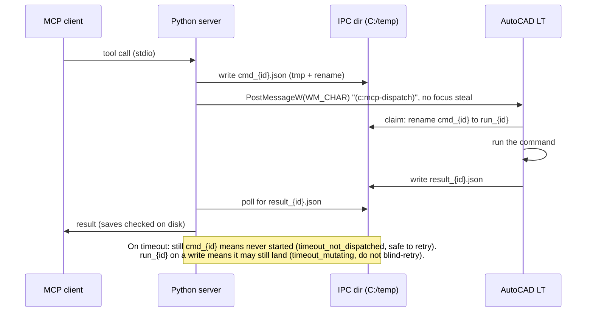

# AutoCAD MCP Server: production-hardened fork

[](https://github.com/WiddlyBits/autocad-mcp/actions/workflows/ci.yml)

**Let an AI assistant like Claude work in AutoCAD LT for you, and trust what it tells you.**

This is an improved version of [puran-water/autocad-mcp](https://github.com/puran-water/autocad-mcp).
Both connect an AI assistant to AutoCAD LT so it can draw, edit and inspect drawings for you. This
version has been used every day on real engineering drawings, and every problem found along the way
has been fixed and covered by a test.

> **New to this?** AutoCAD LT is drafting software used for technical drawings. MCP is the standard
> way to plug a tool into an AI assistant. This repo is that plug.

## Why start here instead of the original?

1. **It doesn't claim work it didn't do.** The original can report "saved" when nothing was saved.
   That happened on a real drawing. Here every save and DXF export is checked on disk
   before the assistant is told "done".
2. **It costs less to run.** AI assistants are billed by how much they read. The original sends every
   result twice and every screenshot at full size. Here results are sent once, a screenshot costs
   less than half as much by default, and a close-up of one area costs about a fifth as much.
3. **It answers with measurements, not pictures.** To find out whether two things overlap or what a
   label says, the original can only take a screenshot and look. Here the assistant asks the drawing
   directly and gets exact numbers and text back.
4. **When something goes wrong, it says what happened and whether it's safe to try again.** If
   AutoCAD is busy, in the middle of another command, or showing a different drawing, this version
   stops and says so. It won't act on the wrong drawing or do the same step twice.
5. **It's tested.** It has 800+ automated tests that run on every change. The original has 123, and
   they can't be run out of the box.

### New in this fork

| Feature | What it does for you |
|---|---|
| **Drawing probes** | Ask "does this overlap?", "what does this label say?" or "is this area empty?" and get an exact answer, with no screenshot |
| **Selection handoff** | Select objects in AutoCAD yourself, and the assistant works on exactly those |
| **Switch drawings** | Moves between open drawings with no click, and confirms which one is active |
| **Read the command line** | The assistant sees AutoCAD's prompts and errors while a command is running |
| **Screenshot controls** | Crop to one area, save to disk instead of reading the image, and see each capture's cost |
| **Assistant skills** | Ready-made working rules that teach the assistant to drive AutoCAD safely ([`skills/`](skills/)) |
| **Automatic testing** | Every change is tested on GitHub before it lands |

### Improved over the original

| Area | Original | This fork |
|---|---|---|
| Saving and DXF export | Reports success without checking. A failed save said "saved", and DXF export wrote no file at all | Checks the file on disk and reports failure if it isn't there |
| Running cost | Every result sent twice; screenshots at full size | Sent once; screenshots capped at 1280 px (56% fewer tokens on a typical window) |
| Timeouts | "Timed out" | Says whether the action never started (safe to retry) or may still finish (don't repeat it) |
| Busy AutoCAD or wrong drawing | Can type into a running command or act on the wrong drawing | Refuses and says why |
| Erasing | Erasing something already erased brought it back | Reports "not found" |
| Opening a drawing | Reports success while opening nothing | Says it can't, and names the drawing that is still active |
| Object details | Type, handle and layer only | Full geometry and extents, the same from both backends |
| Safety labels | Marks the tool that runs any code as read-only | Each tool labelled correctly, so the assistant knows which actions need your OK |

Known limits are listed openly in [docs/known-issues.md](docs/known-issues.md). Error codes and
when a retry is safe: [docs/error-model.md](docs/error-model.md).

## What this made possible

Real problems from daily drafting work that the original could not handle, and what happens now.

| Before (original) | Now (this fork) |
|---|---|
| **PDF plotting silently did nothing.** The plot command was fed its answers in the wrong order, so the file path landed on the wrong question and no PDF appeared. There was no reliable way to batch-export drawings. | `drawing(plot_pdf)` sends AutoCAD LT 2027's real 18-step plot sequence, captured from a manual run. The included save-verification skill has the assistant confirm the PDF landed. Combined with drawing switching, the assistant can plot one open drawing after another. Currently set up for ARCH D landscape sheets. |
| **The assistant couldn't move between open drawings.** You had to click the other tab yourself, every time. | `system(switch_doc)` switches with no click and confirms the switch by asking AutoCAD which drawing is active. |
| **The assistant couldn't see the command line.** When a command stopped at a prompt or failed, you had to copy and paste the command history into the chat by hand. | `system(command_line)` reads the command line and its history directly, even while a command is waiting for input. |
| **The assistant couldn't work on "the lines I selected".** Your selection in AutoCAD did not carry over, and describing one selection took four separate round trips. | Selection handoff: you select, and one call reports what's selected and edits exactly those objects. In the sessions that prompted it, 129 of 193 tool calls had been spent on this kind of back-and-forth. |
| **"Saved" didn't mean saved.** A failed save reported success, and the drawing that was still open was the original. | Every save and DXF export is checked on disk. If the file isn't there, you're told. |

Each fix is backed by tests, and the working rules the assistant follows are in [`skills/`](skills/),
so a beginner doesn't need to know any of this to benefit from it.

## Contributing back upstream

The improvements are going back to the original as a stack of small pull requests. Each one has its
own tests and a green CI run:

| PR | Change | Tests after |
|---|---|---|
| [#2](https://github.com/WiddlyBits/autocad-mcp/pull/2) | Build + CI: runnable tests, ruff, GitHub Actions | 123 |
| [#3](https://github.com/WiddlyBits/autocad-mcp/pull/3) | Stop sending every tool result twice | 131 |
| [#4](https://github.com/WiddlyBits/autocad-mcp/pull/4) | Screenshot cost controls | 169 |
| [#5](https://github.com/WiddlyBits/autocad-mcp/pull/5) | `readOnlyHint` / `destructiveHint` on every tool | 178 |
| [#6](https://github.com/WiddlyBits/autocad-mcp/pull/6) | Entity geometry and extents, same shape on both backends | 227 |
| [#7](https://github.com/WiddlyBits/autocad-mcp/pull/7) | Drawing probes: Python reference, AutoLISP port, golden fixtures | 599 |
| [#8](https://github.com/WiddlyBits/autocad-mcp/pull/8) | IPC timeouts, verified saves, stale-state recovery | 640 |
| [#9](https://github.com/WiddlyBits/autocad-mcp/pull/9) | Command claim, active-command refusal, `assert_doc` | 693 |
| [#10](https://github.com/WiddlyBits/autocad-mcp/pull/10) | Error model and retry policy docs | 693 |

Still fork-only for now: selection handoff, measured writes, `system(command_line)`, `switch_doc`,
`drawing(plot_pdf)` and the assistant skills.

## Technical overview

Two backends, one API:

| Backend | Runtime | Requires AutoCAD? | Screenshot |
|---------|---------|-------------------|------------|
| **File IPC** | Windows Python | Yes — AutoCAD LT 2024+ (Windows) | Win32 PrintWindow |
| **ezdxf** | Any platform | No (headless) | matplotlib render |

The server exposes **8 consolidated tools** (`drawing`, `entity`, `layer`, `block`, `annotation`, `pid`, `view`, `system`) over the MCP stdio transport. An MCP client (Claude Desktop, Claude Code, etc.) connects and drives AutoCAD through natural-language requests.

## Prerequisites (File IPC backend)

- **Windows 10/11** (the File IPC backend uses Win32 APIs for focus-free window messaging)
- **AutoCAD LT 2024 or newer** — AutoLISP support was added in LT 2024 for Windows. AutoCAD LT for Mac exists but does **not** support AutoLISP.
- **Python 3.10+** (Windows native — not WSL Python)
- **uv** package manager ([install guide](https://docs.astral.sh/uv/getting-started/installation/))

> The ezdxf headless backend works on any platform (Linux, macOS, WSL) for offline DXF generation without AutoCAD installed.

## Quick Start

### 1. Clone and install

```powershell
git clone https://github.com/WiddlyBits/autocad-mcp.git
cd autocad-mcp
uv sync
```

### 2. Load the LISP dispatcher in AutoCAD LT

Open AutoCAD LT and load `mcp_dispatch.lsp` using **APPLOAD**:

1. Type `APPLOAD` in the AutoCAD command line
2. Browse to `<repo>/lisp-code/mcp_dispatch.lsp`
3. Click **Load**
4. You should see: `=== MCP Dispatch v3.1 loaded ===` and `Ready for commands via (c:mcp-dispatch)`

> **Tip:** Add the file to your AutoCAD Startup Suite (in the APPLOAD dialog) so it loads automatically with every drawing.

### 3. Configure your MCP client

Add to your MCP client configuration (e.g. Claude Desktop `claude_desktop_config.json`):

```json
{
  "mcpServers": {
    "autocad-mcp": {
      "command": "C:\\path\\to\\autocad-mcp\\.venv\\Scripts\\python.exe",
      "args": ["-m", "autocad_mcp"],
      "env": { "AUTOCAD_MCP_BACKEND": "auto" }
    }
  }
}
```

**Key points:**

- The `command` must point to the **Windows Python** inside the project venv (not WSL python).
- `AUTOCAD_MCP_BACKEND` can be `auto` (default — tries File IPC, falls back to ezdxf), `file_ipc` (requires AutoCAD), or `ezdxf` (headless only).

#### Running from WSL

If your MCP client runs in WSL (e.g. Claude Code), launch the server through `cmd.exe` so it runs as a native Windows process:

```json
{
  "mcpServers": {
    "autocad-mcp": {
      "type": "stdio",
      "command": "cmd.exe",
      "args": ["/d", "/s", "/c", "cd /d C:\\path\\to\\autocad-mcp && .venv\\Scripts\\python.exe -m autocad_mcp"],
      "env": { "AUTOCAD_MCP_BACKEND": "auto" }
    }
  }
}
```

### 4. Verify

From your MCP client, call:

```
system(operation="status")
```

You should see `backend: "file_ipc"` if AutoCAD is running, or `backend: "ezdxf"` for headless mode.

## Tools

### `drawing` — File/drawing management

| Operation | Description | File IPC | ezdxf |
|-----------|-------------|----------|-------|
| `create` | Reset to clean drawing (erase all + purge) | Yes | Yes |
| `open` | Open an existing drawing | No — see below | Yes (DXF) |
| `info` | Get entity count and layers | Yes | Yes |
| `save` | Save current drawing (to path if given) | Yes | Yes |
| `save_as_dxf` | Export as DXF | Yes | Yes |
| `plot_pdf` | Plot to PDF | Yes | No |
| `purge` | Purge unused objects | Yes | Yes |
| `get_variables` | Get system variables by name | Yes | Yes |
| `undo` | Undo last operation | Yes | No |
| `redo` | Redo last undone operation | Yes | No |

### `entity` — Entity CRUD + modification

**Create:** `create_line`, `create_circle`, `create_polyline`, `create_rectangle`, `create_arc`, `create_ellipse`, `create_mtext`, `create_hatch`

**Read:** `list`, `count`, `get`

**Modify:** `copy`, `move`, `rotate`, `scale`, `mirror`, `offset`\*, `array`, `fillet`\*, `chamfer`\*, `erase`

> \* `offset`, `fillet`, `chamfer` are File IPC only (not supported in ezdxf headless backend).

### `layer` — Layer management

`list`, `create`, `set_current`, `set_properties`, `freeze`, `thaw`, `lock`, `unlock`

### `block` — Block operations

| Operation | File IPC | ezdxf |
|-----------|----------|-------|
| `list` | Yes | Yes |
| `insert` | Yes | Yes |
| `insert_with_attributes` | Yes | Yes |
| `get_attributes` | Yes | Yes |
| `update_attribute` | Yes | Yes |
| `define` | No | Yes |

### `annotation` — Text, dimensions, leaders

`create_text`, `create_dimension_linear`, `create_dimension_aligned`, `create_dimension_angular`, `create_dimension_radius`, `create_leader`

### `pid` — P&ID operations (CTO symbol library)

`setup_layers`, `insert_symbol`, `list_symbols`, `draw_process_line`, `connect_equipment`, `add_flow_arrow`, `add_equipment_tag`, `add_line_number`, `insert_valve`, `insert_instrument`, `insert_pump`, `insert_tank`

> P&ID symbol insertion requires the [CAD Tools Online](https://www.cadtoolsonline.com/) (CTO) P&ID Symbol Library installed at `C:\PIDv4-CTO\`. The ezdxf backend has built-in CTO library support. For the File IPC backend, some P&ID operations require additional LISP helpers — see the P&ID section in the wiki for setup details.

### `view` — Viewport and screenshot

| Operation | Description |
|-----------|-------------|
| `zoom_extents` | Zoom to show all entities |
| `zoom_window` | Zoom to a specified window |
| `get_screenshot` | Capture current AutoCAD view as an image |

Screenshots use `PrintWindow` (Win32) for the File IPC backend — works even when AutoCAD is minimized or in the background. The ezdxf backend renders via matplotlib.

`get_screenshot` accepts four cost parameters, since screenshots dominate token usage in long automation sessions:

| Parameter | Default | Description |
|-----------|---------|-------------|
| `region` | `null` | `[left, top, right, bottom]` pixel rect of the captured window, cropped **before** downscaling so the crop keeps full source resolution. Clamped to the image; a region that is empty or entirely outside it is an error rather than a silent full-frame capture. |
| `save_to` | `null` | Write the PNG to this path and return only its path and cost, with **no image attached**. |
| `max_dimension` | `1280` | Cap on the longest side in pixels (clamped to 64–2576, as an argument and not only as an env default). Pass `null` for full resolution; non-positive values are treated as full resolution. Never upscales. |
| `quality` | `null` | If set (clamped to 1–95), encodes JPEG instead of PNG. Shrinks the transferred payload; does **not** reduce token cost. |

Every successful capture reports `width`, `height`, and `est_tokens` — what looking at it costs.

**`region` is the strongest lever, because cropping precedes the downscale.** A 500×400 crop costs 270 visual tokens at native resolution; the whole 1928×1218 window costs 1,334 even after being downscaled to 1280 — and that downscale is exactly what makes small dimension text unreadable. For a detail check a crop is both ~5× cheaper and sharper.

**`save_to` removes the cost entirely rather than reducing it.** The image goes to disk and nothing enters the context window, so a long edit can drop checkpoints as it goes and spend tokens reading back only the one that turned out to matter.

**`max_dimension` is the parameter that controls cost.** Vision models bill an image as `ceil(width/28) * ceil(height/28)` visual tokens — a function of dimensions only, independent of file size or format. A 2560×1440 window costs 4,784 visual tokens uncapped and 1,196 at `max_dimension=1280`; a 1928×1218 window costs 3,036 and 1,334 respectively. Halving the cap roughly quarters the cost.

Two consequences worth knowing:

- **`quality` is not a cost lever.** JPEG shrinks bytes on the wire, not tokens. Its compression artifacts on thin linework and small text buy nothing in usage terms, so reach for it only when transfer or storage size actually matters.
- **Downscaling can make the PNG bigger.** Resampling turns crisp 1px linework into antialiased gradients that deflate compresses poorly — a 1928×1218 AutoCAD capture measured 124 KB uncapped and 253 KB at 1280. The token cost still falls by more than half, so the default is right; just don't expect the file to shrink.

The upper clamp is 2576 because the vision API downscales anything longer before the model sees it (and caps one image at 4,784 visual tokens), so larger captures are transmitted and then discarded. The global default is set by `AUTOCAD_MCP_SCREENSHOT_MAX_DIM`; the other tools' `include_screenshot` option always uses that default.

### `system` — Server management

`status`, `health`, `get_backend`, `runtime`, `init`, `execute_lisp`, `command_line`, `switch_doc`, `assert_doc`

> `switch_doc` makes another open drawing active with no click or keystroke (`data: {dwg: "B.dwg"}`), and is `ok` only when AutoCAD's `DWGNAME` confirms it. How it was found: [docs/investigations/2026-10-16-document-switching.md](docs/investigations/2026-10-16-document-switching.md).

> `execute_lisp` runs arbitrary AutoLISP code (File IPC only). Pass `data: {code: "(+ 1 2)"}`. This turns the server into an extensible automation platform — any valid AutoLISP expression can be executed.

## Architecture

```
MCP Client (Claude)
    │  stdio (JSON-RPC)
    ▼
Python MCP Server (autocad_mcp)
    │
    ├── File IPC Backend ──► C:/temp/*.json ──► mcp_dispatch.lsp (AutoCAD LT)
    │   PostMessageW(WM_CHAR) to MDIClient — no focus steal
    │
    └── ezdxf Backend ──► in-memory DXF (headless, no AutoCAD needed)
```

The File IPC backend sends keystrokes to AutoCAD's MDIClient window via `PostMessageW(WM_CHAR)`, triggering the `(c:mcp-dispatch)` AutoLISP command. This approach does **not** steal window focus — you can continue working in other applications while automation runs.

One File IPC round trip, including how a timeout is classified:



## Environment Variables

| Variable | Default | Description |
|----------|---------|-------------|
| `AUTOCAD_MCP_BACKEND` | `auto` | Backend selection: `auto`, `file_ipc`, `ezdxf` |
| `AUTOCAD_MCP_IPC_DIR` | `C:/temp` | Directory for IPC command/result JSON files (must match on both Python and LISP sides) |
| `AUTOCAD_MCP_IPC_TIMEOUT` | `10.0` | IPC command timeout in seconds (1-300) |
| `AUTOCAD_MCP_ONLY_TEXT` | `false` | Suppress all returned images — both the `include_screenshot` option and `view(get_screenshot)`. The capture still runs and still reports `width`/`height`/`est_tokens`, so you can see what a run *would* have spent without spending it; `save_to` still writes to disk, since that costs no context. |
| `AUTOCAD_MCP_SCREENSHOT_MAX_DIM` | `1280` | Default cap on a screenshot's longest side in pixels (64–2576). Invalid values fall back to the default. |

> **Note:** If you change `AUTOCAD_MCP_IPC_DIR`, you must also update the `*mcp-ipc-dir*` variable in `mcp_dispatch.lsp` to match.

## Development

```powershell
uv sync
uv run pytest tests/ -v
```

## AutoCAD LT AutoLISP Compatibility

AutoLISP was added to AutoCAD LT in the **2024 release (Windows only)**. AutoCAD LT for Mac does not support AutoLISP.

| Supported (LT 2024+ Windows) | Not Supported |
|-------------------------------|---------------|
| `.lsp` / `.fas` / `.vlx` / `.dcl` | VLIDE (Visual LISP IDE) |
| All `vl-*` utility functions, and `vlax-get-acad-object` (LT 2027, measured 2026-10-08) | Full `vlax-*` (ActiveX/COM) is not documented for LT |
| File I/O (`open`, `read-line`, etc.) | Express Tools |
| Entity access (`entget`, `entmod`, etc.) | 3D operations |
| Selection sets | AutoLISP on Mac |

The `mcp_dispatch.lsp` dispatcher is fully compatible with LT 2024+.

## Notable engineering

- **[Switching drawings without a click](docs/investigations/2026-10-16-document-switching.md)** (2026-10-16). LT has no COM, refuses OPEN from LISP, and `vla-Activate` reports a switch that never happens. Synthetic Ctrl+Tab was disproved; `GetGUIThreadInfo` showed the Start tab's embedded Chromium widget holding keyboard focus. Fix: `WM_MDIACTIVATE` on the frame's `MDIClient`, confirmed by `DWGNAME`. Also closed a silent fall-through to the headless backend while Start was in front.

## License

MIT
