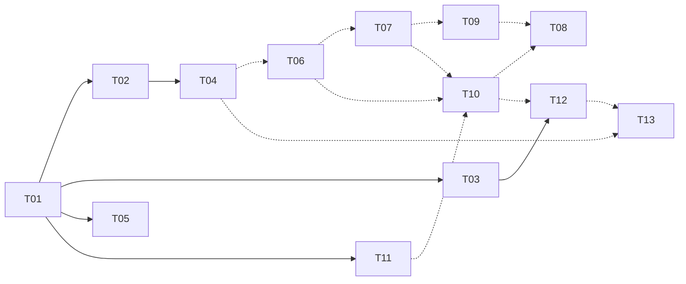

# Fork roadmap

DRAFT, Phase 0 inventory, 2026-10-16. Topic map signed off. T10 split still open.

This fork is 97 commits ahead of `upstream/main` (95 plus 2 merges) and 0 behind. It adds
707 tests (upstream collects 123, fork `main` collects 830). Every commit belongs to exactly one
topic below. The commit-to-topic map is a scratch CSV (Phase 0 artifact, not committed).

## How the topics were tested

Each topic's diffs were replayed onto `upstream/main` + T01 in a throwaway worktree, leaving out
fork-only paths (`CLAUDE.md`, `skills/`, `scripts/sync-skills.ps1`, `tests/test_skill_drift.py`).
After the replay, `pytest -q -W ignore` ran on the result.

- **Builds alone**: the topic replays cleanly and its tests pass. The topic is ready to become
  a branch.
- **Entangled**: some commits don't apply without diffs from other topics. Edges come from the
  history of shared files (the commit that last touched each file belongs to another topic).
  Phase 2 settles each one by building the branch.

The history can't be cherry-picked into clean topics. Work on `file_ipc.py`,
`mcp_dispatch.lsp`, `server.py` and `README.md` was interleaved across topics. Phase 2 branches
get re-committed from each topic's final hunks, not replayed commit by commit.

## Topics

| # | Topic | Commits | Main files | Tests added | Standalone on upstream | Client content to scrub |
|---|---|---|---|---|---|---|
| T01 | Build + CI: uv dependency-groups, GitHub Actions, ruff, Python 3.12 pin, LF for skills | 6 | `pyproject.toml`, `uv.lock`, `.github/workflows/ci.yml`, `.python-version`, `.gitattributes` | 0 (makes upstream's 123 runnable: `pytest` isn't installable via `uv run` on upstream) | **builds**, 123 passed | none |
| T02 | Stop sending every tool result twice via `structuredContent` | 1 | `server.py` | 8 | **builds**, 131 passed | none |
| T03 | MCP 2025.11 `readOnlyHint`/`destructiveHint` tool annotations | 1 | `server.py` | 0 | conflicts in `server.py` only (textual), re-commit | none |
| T04 | Screenshot cost controls: `max_dimension`, `region`, `save_to`, no-image mode | 2 | `screenshot.py`, `config.py`, backends, `server.py` | 38 | **builds**, 161 passed | 1 comment (`test_screenshot_region.py:51`, names a person's laptop) |
| T05 | `token_audit`: measure where a session's tokens went | 1 | `tests/token_audit.py` | 17 | **builds**, 140 passed | none in code; upstream fit is a question (it reads Claude Code transcripts) |
| T06 | Entity geometry + extents, AutoLISP/ezdxf parity, not-found for erased handles | 3 | `mcp_dispatch.lsp`, `ezdxf_backend.py`, `server.py` | 50 | entangled: `4ecc541` needs `docs/known-issues.md` (T10) | `test_entity_geometry.py:142` (reviewer's name) |
| T07 | Probes: Python-proven arithmetic, AutoLISP port, golden `.snap` fixtures, `probe_dxf --text` | 6 | `probes.py`, `probe_dxf.py`, `mcp_probes.lsp`, `tests/golden/` | ~389 (`test_probes_lisp.py` is shared with T08) | entangled: 17 failed; `eadcdc2` needs T09's `probe_dxf.py` | heavy: reviewer name, `ECSI_Backpan`, "DO Draft 2" in `probes.py`, `probe_dxf.py`, `mcp_probes.lsp`, `test_probes.py`, `test_probe_snapshot.py` |
| T08 | Verified writes: measure save/open/DXF export/switch rather than report them; stale-dispatcher detection | 12 | `mcp_dispatch.lsp`, `test_probes_lisp.py`, `test_measured_results.py`, `test_dispatcher_freshness.py` | 19 + share of `test_probes_lisp.py` | entangled with T06, T07, T10 (`mcp_dispatch.lsp`, `file_ipc.py`) | `mcp_dispatch.lsp:407,429` (a person's name, "DO Draft 2"), `test_probes_lisp.py:457` |
| T09 | Selection handoff: `mcp_select.lsp`, preflight, `mcp:guard` bare-name match | 4 | `mcp_select.lsp`, `file_ipc.py`, `server.py` | 99 | entangled: needs T07 (`probe_dxf.py`) | drawing names in `mcp_select.lsp:9,397-404` and `test_preflight.py:114-120` |
| T10 | File-IPC hardening: timeouts, stale-IPC/hwnd recovery, `IsQuiescent`, command claim, `assert_doc`, error model + retry policy docs | 15 | `file_ipc.py`, `base.py`, `server.py`, `docs/error-model.md`, `docs/known-issues.md` | 40 (+22 in `test_ipc_protocol.py`, 18 in `test_dispatch_claim.py`) | entangled: hub topic (T01, T07, T08, T09, T11) | `test_ipc_protocol.py:615-629` (client template filename), `test_dispatch_claim.py:3`, `known-issues.md:15`; `605e3e9` also edits the title-block skill (split it) |
| T11 | `drawing(plot_pdf)`: working `-PLOT` sequence for LT 2027 | 4 | `mcp_dispatch.lsp` | **0** | **builds**, 123 passed | **paper size is hard-coded** (`"ARCH D (36.00 x 24.00 Inches)"`, `mcp_dispatch.lsp:1739`); commit subject names the client |
| T12 | `system(command_line)`: read the command line while a command runs; multi-window warning | 4 | `command_line.py`, `file_ipc.py`, `server.py` | 22 | entangled: needs T10 (`base.py`, `file_ipc.py`) and T03 (`server.py`) | none |
| T13 | `switch_doc` via `WM_MDIACTIVATE`, Start-tab guard, investigation write-up | 4 + merge | `doc_switch.py`, `config.py`, `docs/investigations/` | 18 | entangled: needs T12 (`server.py`), T04 (`config.py`) | none (A/B naming already applied) |
| F1 | Fork-only: `CLAUDE.md` (test counts, git regime) | 13 | `CLAUDE.md` | — | never goes upstream | — |
| F2 | Fork-only: AutoCAD skills, `sync-skills.ps1`, skill drift test | 20 | `skills/`, `scripts/sync-skills.ps1`, `tests/test_skill_drift.py` | 7 | never goes upstream as-is | `title-block-text` is client-specific by design; workflow skill has 8+ hits |

Mixed commits that have to be split by path while re-committing: `ea67f7c`, `a8c8aa2`,
`3ef91db`, `605e3e9`, `cf5c02b` (IPC claim + `.dwt` SAVEAS + plot DBMOD), `187b6b8`, `76665cd`,
`b1667fd`, `4ecc541`, `f82a21f`, `c7fdb8f`.

## Dependency DAG

Solid arrows are verified, or are textual conflicts only. Dashed arrows are inferred from
shared-file history, and Phase 2 confirms them.

T08 and T10 have edges in both directions in the commit history (they were built together on
`file_ipc.py` and `mcp_dispatch.lsp`). The order above puts the IPC substrate (T10) first and
the verification layer (T08) on top of it. If T10 is too large to review in one go, split it:
T10a timeouts + stale recovery, T10b claim + `assert_doc`, T10c docs.

## PR order

| Order | Topic | Why it's here |
|---|---|---|
| 1 | T01 build + CI | Upstream has no CI, and `uv run pytest` can't install pytest there. Every later PR shows green checks because of this one |
| 2 | T02 structuredContent | One commit, +8 tests, clear token win. A good first review |
| 3 | T04 screenshot cost | Self-contained, +38 tests, measured result already in hand |
| 4 | T03 annotations | Small, spec-driven |
| 5 | T06 entity geometry | Foundation for the probes |
| 6 | T07 probes | Biggest test payload. Heaviest scrub |
| 7 | T10 IPC hardening (maybe 10a/b/c) | The substrate under T08/T12/T13 |
| 8 | T09 selection handoff | |
| 9 | T08 verified writes | |
| 10 | T12 command_line | |
| 11 | T13 switch_doc | Fork PR #1 was this topic. The investigation template comes from here |
| — | T05 token_audit | Fork-only for now (decision 1) |
| — | T11 plot_pdf | Fork-only for now (decision 2) |
| — | F1, F2 | Fork only. They ship in fork releases, not upstream PRs |

## Decisions (Gianni, 2026-10-16)

1. T05 `token_audit`: fork-only for now. It gets another update before any upstream PR.
2. T11 `plot_pdf`: fork-only for now. The paper size and sequence are specific to client work.
3. T10: one PR or a split is still open (pros and cons are in the session notes).
4. F2 skills: later, a cleaned-up generic `autocad-mcp-workflow` skill. `title-block-text` stays fork-only.
